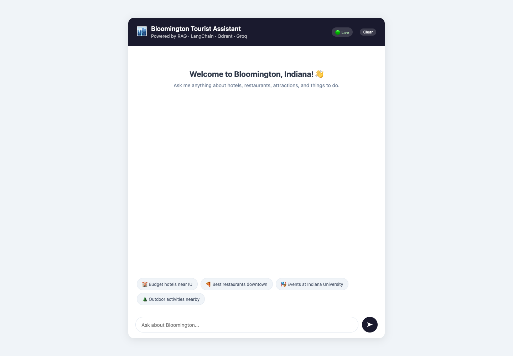
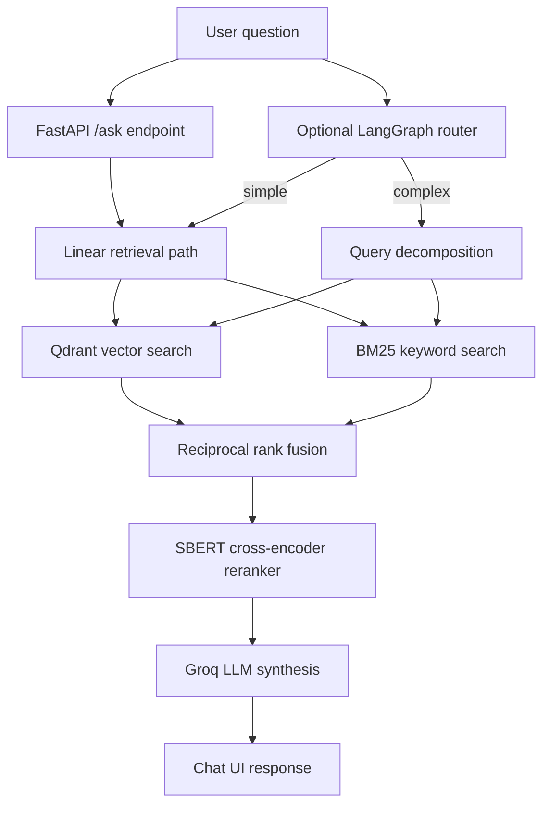

# Bloomington Tourist Assistant

A RAG service for Bloomington, Indiana tourism questions. The system combines vector search, BM25, reciprocal rank fusion, cross-encoder reranking, a FastAPI linear path, and an optional LangGraph path.

Deployment status: unavailable as of October 21, 2026 because billing is disabled for the existing Cloud Run project. See [`docs/deployment.md`](docs/deployment.md); no billing change was made.



## Architecture



## Proof points

| Area | Evidence |
| --- | --- |
| Retrieval quality | Versioned hit@k, MRR, and recall@k harness; baseline results are committed after reproducible runs |
| CI gate | GitHub Actions compares retrieval results with the committed baseline |
| Faithfulness check | Optional zero-cost local Ollama judge; publish only after agreement with human labels |
| Deployment | GCP Cloud Run with a FastAPI backend and static chat UI |
| Known tradeoff | In-memory Qdrant rebuilds on cold start |

## Measured evaluation results

Measured locally on October 21, 2026 using the versioned 60-case `v1` dataset. Retrieval metrics use the 50 answerable cases; the 10 unanswerable cases are reserved for generation/refusal evaluation.

| Configuration | Pipeline | Hit@3 | MRR | Recall@5 | p50 retrieval |
| --- | --- | ---: | ---: | ---: | ---: |
| Dense only | Linear | 0.940 | 0.838 | 0.930 | 4 ms |
| Hybrid, no reranker | Linear | **0.980** | **0.935** | **0.970** | 6 ms |
| Current production baseline | Linear | 0.920 | 0.890 | 0.940 | 45 ms |
| Current retrieval + multi-query decomposition | LangGraph | 0.960 | 0.927 | 0.950 | 45 ms |

These are corpus-retrieval measurements, not independently verified factual-accuracy claims. Full result JSON files are under `evals/results/`.

### What the evals caught

The existing SBERT reranker was assumed to improve retrieval, but the controlled run showed the opposite on `v1`: removing it raised hit@3 from 0.920 to 0.980, raised MRR from 0.890 to 0.935, and reduced measured median retrieval time from 45 ms to 6 ms. The deployed behavior has not been changed automatically; the current configuration remains the protected baseline until the seed cases receive human review.

The five multi-hop cases also exposed the linear pipeline's weakness: its multi-hop hit@3 was 0.600. Dataset-guided multi-query decomposition removed those multi-hop hit@3 failures. This does not yet measure the live LLM router; that requires a local Ollama run.

## Tech stack

- FastAPI, Uvicorn
- LangChain, LangGraph
- Qdrant in-memory vector store
- BM25, reciprocal rank fusion, SBERT reranking
- Groq generation for the deployed linear API; local Ollama for zero-cost agentic evaluation
- GitHub Actions
- GCP Cloud Run

## Setup

```bash
git clone https://github.com/prathima-sola/bloomington-rag
cd bloomington-rag
python -m venv venv
source venv/bin/activate
pip install -r requirements.txt
cp .env.example .env
python src/prepare_data.py
uvicorn src.api:app --reload --port 8000
```

Open `http://localhost:8000`.

## Environment

```bash
GROQ_API_KEY=
```

The retrieval quality test does not need an API key. The live answer generation path needs `GROQ_API_KEY`.

## Evaluation commands

```bash
python -m pytest -q
python -m evals.runners.run_eval --config evals/configs/baseline.yaml
python -m evals.runners.run_eval --config evals/configs/baseline_langgraph.yaml
```

The versioned evaluation harness is documented in [`evals/README.md`](evals/README.md). Retrieval evaluation is free and deterministic. Generation evaluation uses local Ollama and never falls back to a paid API.

## Deployment notes

- `Procfile` starts the FastAPI app for Cloud Run.
- The app loads processed documents, builds the in-memory Qdrant index, and serves the chat UI from `src/static`.
- Cold starts rebuild the vector index. A managed Qdrant instance would remove that rebuild time.

## Project structure

```text
bloomington-rag/
├── src/
│   ├── api.py
│   ├── rag_pipeline.py
│   ├── agentic_rag.py
│   ├── prepare_data.py
│   └── static/index.html
├── data/processed/
├── evals/
│   ├── datasets/v1.jsonl
│   ├── metrics/
│   ├── runners/run_eval.py
│   ├── configs/
│   ├── baselines/
│   └── results/
├── tests/
│   ├── test_retrieval.py
│   ├── faithfulness_eval.py
│   └── eval_dataset.py
├── .github/workflows/eval.yml
└── Procfile
```

## Known limits

- The dataset is heavier on hotels than restaurants and attractions.
- Qdrant runs in memory for this version.
- The source data is static, so events, hours, and prices can age.
- The original corpus has no authoritative source URLs. Current eval cases measure corpus retrieval, not independent factual correctness.
